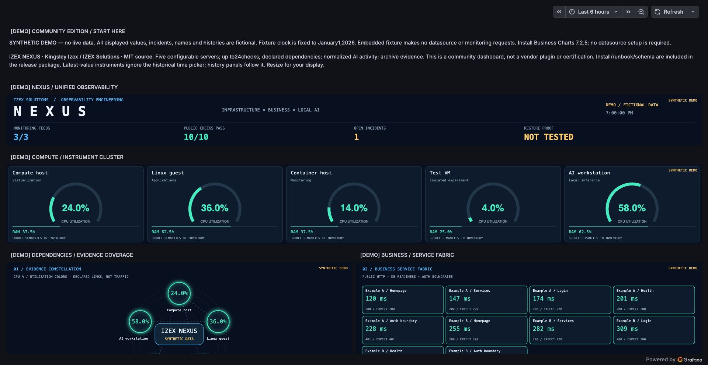

# IZEX NEXUS Community

**Infrastructure, business and local AI observability — by Kingsley Izex / IZEX Solutions.**

A reusable Grafana dashboard design with explicit evidence freshness, a compute instrument cluster, a dependency constellation, business checks, AI work observations, archive evidence and capacity pressure.

[](docs/NEXUS-community-demo.jpg)

[Source repository](https://github.com/kashbeats/izex-nexus-community) · [Demo JSON](dist/nexus-community-demo.json) · [Live JSON](dist/nexus-community-live.json)

## Choose an edition

| Edition | What it shows | Requirements |
|---|---|---|
| Synthetic Demo | Fictional, fixed examples of every visual | Grafana13.2.1 and Business Charts7.2.5; no datasource, API, account token or network request |
| Live Adapter | Your own configured observations; unconfigured data stays unknown | Infinity4.1.1 and a compatible fixed read-only adapter; optional Prometheus datasource for history |

The demo is a visual example, **not a live monitoring dashboard**. All names, measurements, incidents and histories are fictional. Every panel title is labelled DEMO, with additional synthetic-data labels. The fixture clock is fixed to January1,2026; it never advances and does not measure availability. Live dashboards cannot enable demo behavior through an upstream `demo` flag.

Tested on Grafana13.2.1, Business Charts7.2.5 and Infinity4.1.1. Older/newer versions remain unverified. These are dashboards using existing plugins, not a new signed Grafana plugin or a certification.

## Quick start: use your existing Grafana

1. Install the signed **Business Charts** plugin (`volkovlabs-echarts-panel`, tested7.2.5).
2. Import `dist/nexus-community-demo.json` through Dashboards → New → Import. No datasource mapping or adapter is needed for the demo.
3. Choose a dark theme. View the demonstration; every value is synthetic.
4. For real data, install Infinity, configure the adapter below, then import `dist/nexus-community-live.json` and select your Infinity and Prometheus datasources. Set the Adapter URL variable. Optional history panels can be removed if the required Prometheus metrics do not exist.

## Optional isolated Docker quick start

Requires Docker Engine with Compose v2. Build files are supplied; local host builds beyond the tested homelab runtime are not independently certified.

```sh
python3 build.py
# Choose a strong new local password. Do not commit it or your environment file.
export GRAFANA_ADMIN_PASSWORD='replace-with-your-own-strong-password'
docker compose up -d --build grafana
```

Open http://localhost:3300 and log in as admin with your chosen password. Port3300 binds only to loopback. The demo is under NEXUS Community. No paid Grafana Cloud service or live homelab exposure is required.

## Configure the live adapter

Python3.9+ with the standard library; no pip dependencies. The adapter calls Zabbix `item.get` for at most100explicit item IDs and optional fixed Prometheus instant queries. It serves only cached GET `/snapshot` and `/healthz`. It performs no resource discovery, application probes, writes, repairs, backups, model calls or event collection. Its incident count is intentionally unknown. A richer compatible adapter may supply incident evidence explicitly.

1. Copy `adapter/config.example.json` to `adapter/config.json`. The example addresses/IDs are fictional and will not work unchanged.
2. Set up your own scoped **read-only** Zabbix identity, grant only the intended hosts and `item.get`, and create its token. The token goes in `NEXUS_ZABBIX_TOKEN`, not JSON, dashboard variables, URLs or source control. Zabbix7.0.31 bearer authentication was tested.
3. Configure up to five server IDs, names, role labels and existing numeric item IDs. CPU must be percent0–100; memory/disk capacity is bytes. Do not map a fraction0–1 or kilobytes without converting it at the source. Map `memory_used` explicitly for hypervisor RAM; derivation from total−available applies only if `memory_used` is omitted, both samples are fresh, and their clocks are within60seconds. See `docs/schema.md`.
4. Configure at most24business checks. Map the web scenario's **failed step** item; zero indicates that the existing scenario passed its configured checks. Optional HTTP-code/latency mappings must also be fresh if supplied. An expected401 can pass. Missing HTTP status is shown as `?`, never invented.
5. Configure Prometheus URL, fixed normalized AI expressions and a freshness expression if desired. Expressions must return one instant-vector sample after aggregation. Only fields with valid samples appear; empty results stay unknown. A failed scrape/future observation clock must be filtered by your freshness expression. Default examples target the published `izex_ai_*` naming convention, not standard Prometheus metrics automatically present in every lab.
6. Optional archive evidence comes from a small local JSON file produced by **your own collector**, not by this adapter. It needs a current collection clock and valid archive timestamps. See schema. If unconfigured or stale, the archive view is unknown. No restore test is inferred.

Run locally:

```sh
export NEXUS_ZABBIX_TOKEN='your-read-only-token'
export NEXUS_ADAPTER_TOKEN='your-new-adapter-reader-token'
python3 adapter/server.py --config adapter/config.json --bind 127.0.0.1 --port 8096
```

Grafana's backend, not the viewing browser, must be able to reach the adapter. `localhost` in a Grafana container means that container. For the supplied Compose topology, export the same adapter token, set `NEXUS_ZABBIX_TOKEN`, then run `docker compose --profile live up -d --build`. Use `http://adapter:8096/snapshot` in the Live dashboard. The adapter is internal to Compose and has no published host port. Non-loopback adapter binding requires its reader token. For another deployment, use a controlled internal network or authenticated TLS reverse proxy; TLS validation remains enabled for HTTPS upstreams. The adapter rejects redirects. Do not expose a plain HTTP bearer token over an untrusted network.

In Infinity, set allowedHosts to the **exact adapter origin**. Configure a backend Authorization header with `Bearer <your-adapter-reader-token>` in secure datasource settings. Authentication is never placed in public dashboard JSON. The Compose datasource demonstrates environment-based provisioning. Upstream and adapter credentials are distinct. No Zabbix/Prometheus credentials are served by the adapter.

## History panels

The live dashboard uses a selectable Prometheus datasource. Kubernetes history expects `container_cpu_usage_seconds_total` with `pod`, `namespace` and `container` labels. The namespaces multi-select defaults to All. The AI history expects `izex_ai_jobs{workflow,status}`, `izex_ai_snapshot_timestamp_seconds` and `up{job=...}`; the scrape job is configurable. These metrics are not installed by this dashboard. CPU history uses a five-minute rate of a counter; retained AI outcomes are gauges, never rates. Latest-value graphics ignore the history time picker; history panels follow it.

## Evidence semantics

A live snapshot expires after120seconds, source coverage must be complete, samples expire after180seconds, and future clocks are rejected. Missing values never become zero. Utilization colors (<75% teal,75–89.9% amber,≥90% rose) are visual bands, not alert rules. The constellation is configured relationships, never observed packets or root-cause proof. Capacity layers overlap; do not sum hypervisor/guest RAM, storage pools and guest filesystems or shared volumes. Public HTTP results do not prove private transactions. A recent/checksummed archive is not a restore test. Citations and completed AI jobs do not prove factual correctness.

Infinity4.1.1 exposes backend JSON at `frame.meta.custom.data`; the chart core also accepts a serialized `snapshot` field. This observed metadata shape is a version-sensitive dependency, documented and tested. Verify it before plugin upgrades. There is no live fallback to demo data.

## Test and build

```sh
python3 -m unittest discover -s tests -p 'test_*.py' -v
node --test tests/charts.test.cjs
python3 build.py
```

The tests include a local HTTP socket for read-only routes/auth. Tests use fictional data and mock upstream calls. Browser QA exercised both the demonstration and the unknown-data behavior on the existing homelab plugins. Scope of live adapter verification is recorded in `docs/verification.md`.

## Contribution and attribution

New code is MIT licensed. Grafana, Business Charts/Apache ECharts, Infinity and Python retain their own licenses; no vendor source is bundled. Development used AI assistance with source review, policy tests and live runtime checks. This project is a community dashboard contribution, not an official Grafana integration, endorsement or accepted Champions membership. Do not publish your credentials, actual monitoring history or customer-specific details when adapting it.

Original private NEXUS deployment remains separate from this public edition. Local runtime paths, private network addresses, API credentials and client history are excluded. Please use a GitHub issue to report a reproducible bug without secrets. Documentation corrections and adapter mappings are useful contributions.

## References

- [Grafana: publish a community dashboard](https://grafana.com/docs/grafana/latest/visualizations/dashboards/share-dashboards-panels/#publish-a-community-dashboard)
- [Business Charts](https://grafana.com/grafana/plugins/volkovlabs-echarts-panel/)
- [Infinity backend parser](https://grafana.com/docs/plugins/yesoreyeram-infinity-datasource/latest/query/backend/)
- [Zabbix item.get](https://www.zabbix.com/documentation/7.0/en/manual/api/reference/item/get)
